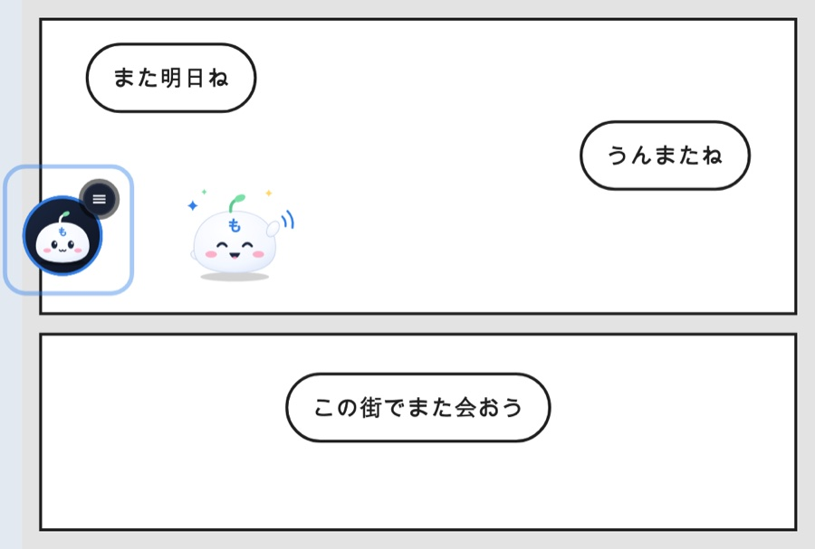
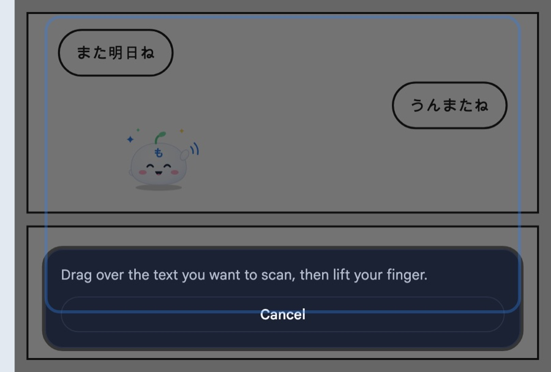
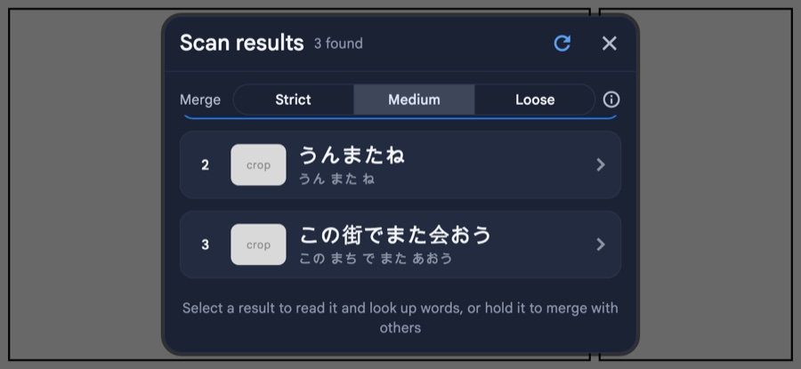
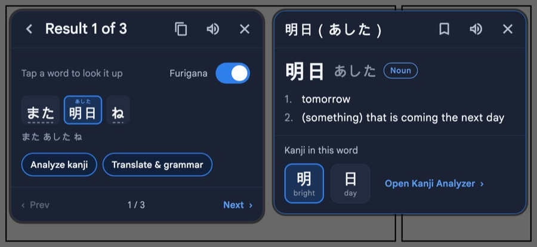

Japanese servers get events and story chapters first, often untranslated. You can't copy text out of a game, and camera translators mean juggling two devices.

## Overview of Mojimo

Mojimo was built for Japanese learners, but it is just as useful if you simply want to follow the story of a game that hasn't been translated. It puts a small floating button on top of any app, so you can scan the text in your game without switching away or picking up a second device. Tap the button, drag a box around the dialogue, and every line is split into words with furigana. Tap a word to see its reading, meanings and kanji from an offline dictionary, and save it to your Library to review later.

With Mojimo Pro, **Translate & grammar** gives you a full translation of the line, powered by Google Gemini, with every word and grammar point explained. Extra settings let you be more precise: keep the same scan area for a whole session, merge lines that the game split apart, turn furigana on or off, and show readings in kana or romaji.

Mojimo is designed to be quick to set up. Allow it to show over other apps, turn on the floating button, and you can scan your first line in under a minute. The text is read on your phone with Google's on-device text recognition, and the screenshot is deleted right after. Nothing leaves your phone unless you ask for a translation, and then only the text of that line is sent.

## How to scan your game with Mojimo

1. Install **Mojimo** from [Google Play](https://play.google.com/store/apps/details?id=com.teeendvn.mojimo.prod) and open it.
2. On the **Scan** tab, tap **Allow displaying over other apps** and switch Mojimo on in Android settings.
3. Tap **Enable floating scan button**.
4. Open your game and tap the floating button when text is on screen.

   <figure>
     
     <figcaption>The floating button stays on top of your game.</figcaption>
   </figure>

5. Allow screen capture when Android asks. If you're offered a choice, share the entire screen. Android asks once per session.
6. Drag a box around the text you want to read.

   <figure>
     
     <figcaption>Draw a box around the dialogue.</figcaption>
   </figure>

   > If the dialogue box stays in one place, set **Settings → Scan area** to **Each session** so you don't drag a box every time.

7. Tap a result, then tap a word to see its reading and meaning. Tap the bookmark to save it.

   <figure>
     
     <figcaption>Each block of text becomes a result.</figcaption>
   </figure>

   <figure>
     
     <figcaption>Tap a word for its reading, meanings and kanji.</figcaption>
   </figure>

8. Close the window and keep playing.

## Conclusion

Mojimo turns any Japanese gacha game into something you can read: tap, scan and look up words without leaving the game. Scanning and lookups are free, and the words you save are waiting in your Library when you want to study them.
